# TP : Mise en place du protocole SSH

**DGI-ESP / UCAD, L3 GLSIA, Services Réseaux Avancés, 2026-2027**
**Enseignant :** Dr. GUEYE
**Étudiantes :** _Sokhna Aichatou Amanatoulaye Fall_ et _El Hadji Mamadou Thiam_
**Date :** 18/11/2026

---

## Objectif

Comprendre comment utiliser SSH pour sécuriser l'accès à une machine distante : installer un serveur SSH, s'y connecter depuis un client, configurer l'authentification par clés, puis créer un tunnel SSH pour faire transiter d'autres protocoles (HTTP, MariaDB).

## Environnement

| Élément | Valeur |
|---|---|
| Serveur | Machine virtuelle VirtualBox `serveur-ssh`, Ubuntu 24.04.4 LTS |
| Utilisateur du serveur | `mame` |
| Réseau du serveur | Accès par pont (Wi-Fi), adresse `192.168.1.21` |
| Client | PC Windows 11 (client OpenSSH, PowerShell) |

**Différences avec l'énoncé :** Ubuntu 24.04 au lieu de 22.04, un seul serveur (le client est Windows) et la commande `ss` à la place de `netstat`, qui n'est pas installé par défaut.

---

## 1. Installation du serveur SSH

```bash
sudo apt update
sudo apt install openssh-server
sudo systemctl enable ssh
sudo systemctl start ssh
sudo systemctl status ssh
apt policy openssh-server
sudo ss -tlnp | grep 22
```

Le service est `active (running)` et le port 22 est en écoute.

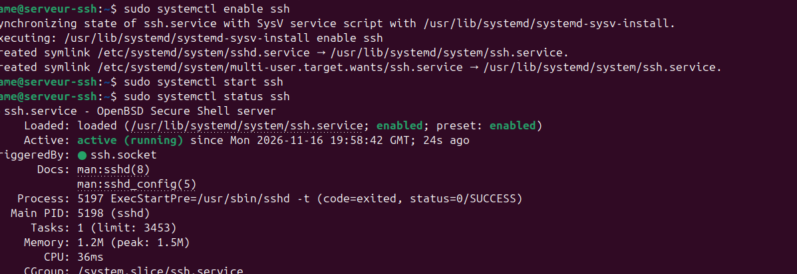

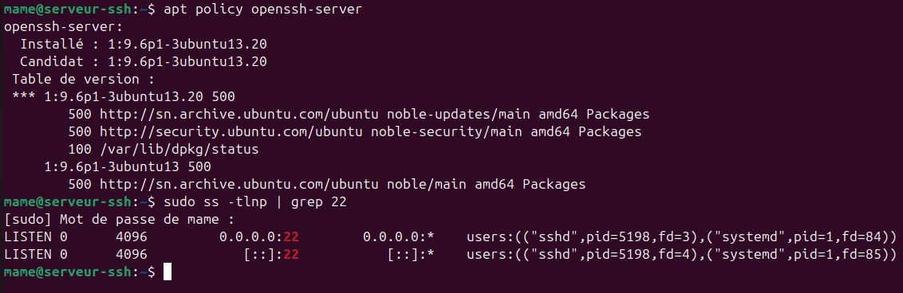


## 2. Connexion SSH depuis le client Windows

Adresse IP du serveur :

```bash
ip a
```

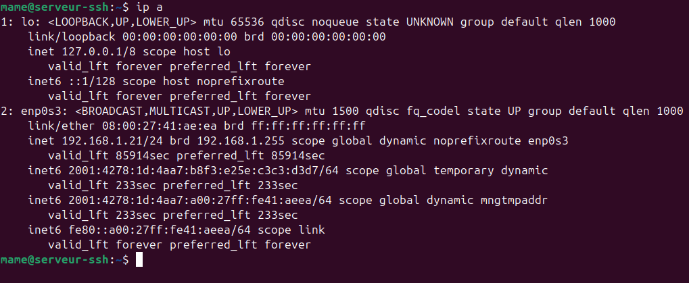

Connexion depuis Windows :

```powershell
ssh mame@192.168.1.21
```

À la première connexion, l'empreinte du serveur est acceptée (`yes`) et enregistrée dans `known_hosts`. Le mot de passe de `mame` est ensuite demandé.

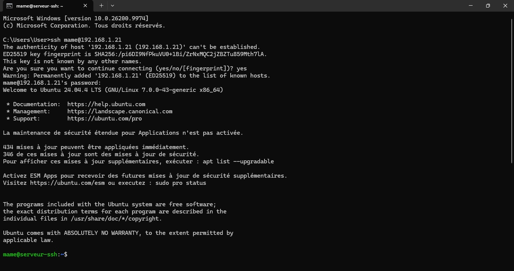

## 3. Configuration des clés SSH

### Génération de la paire de clés sur le serveur

```bash
ssh-keygen -t ed25519
ls -a
cd .ssh
ls
cat id_ed25519.pub
```

Deux fichiers sont créés : `id_ed25519` (clé privée) et `id_ed25519.pub` (clé publique).

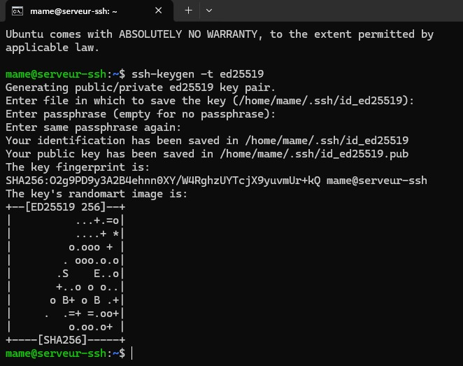


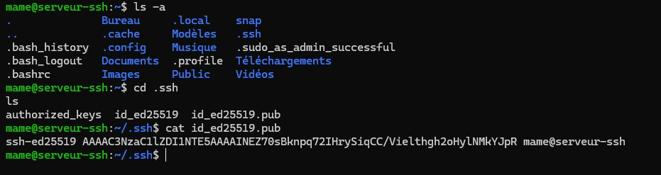

### Connexion sans mot de passe

Le client Windows génère sa propre paire de clés, puis sa clé publique est ajoutée au fichier `~/.ssh/authorized_keys` du serveur :

```powershell
ssh-keygen -t ed25519
type $env:USERPROFILE\.ssh\id_ed25519.pub | ssh mame@192.168.1.21 "mkdir -p ~/.ssh && cat >> ~/.ssh/authorized_keys"
ssh mame@192.168.1.21
```

Après l'envoi de la clé, la connexion se fait **sans mot de passe**.

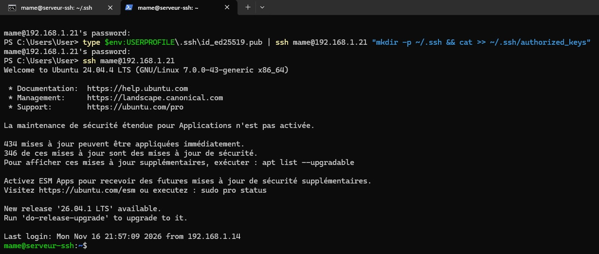


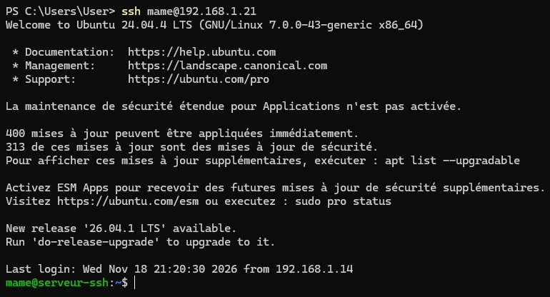

> **Remarque :** l'énoncé demande d'envoyer la clé publique du serveur vers un client Linux avec `scp`. Nous n'avions pas de seconde machine Linux, nous avons donc utilisé la méthode standard (clé du client déposée sur le serveur), qui donne le même résultat attendu : une connexion sans mot de passe.

## 4. Tunnel SSH

### Serveur web Apache

```bash
sudo apt install apache2
sudo systemctl enable apache2
sudo systemctl start apache2
sudo systemctl status apache2
sudo apt install curl
curl http://127.0.0.1
```

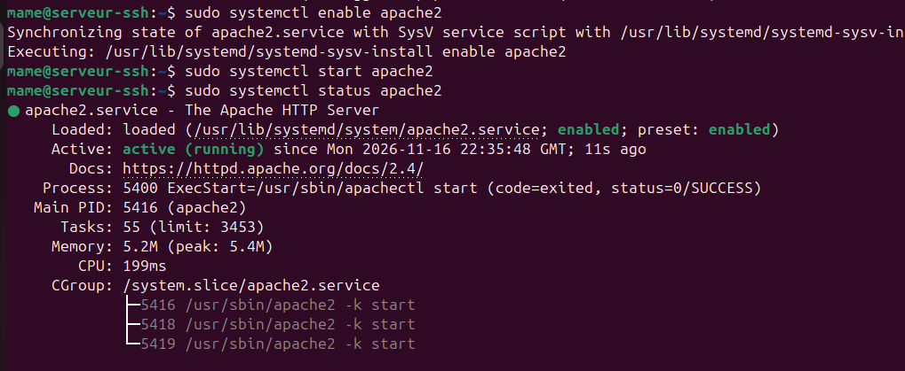

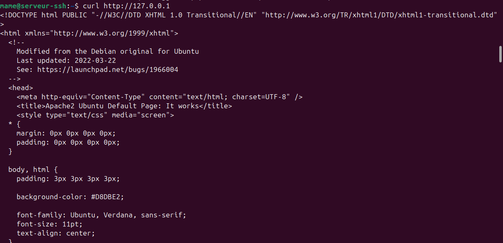

### Tunnel vers le serveur web

Depuis Windows :

```powershell
ssh -L 1024:127.0.0.1:80 mame@192.168.1.21
```

Le port 1024 du PC est redirigé, de façon chiffrée, vers le port 80 du serveur. Dans le navigateur Windows, `http://localhost:1024` affiche la page par défaut d'Apache.

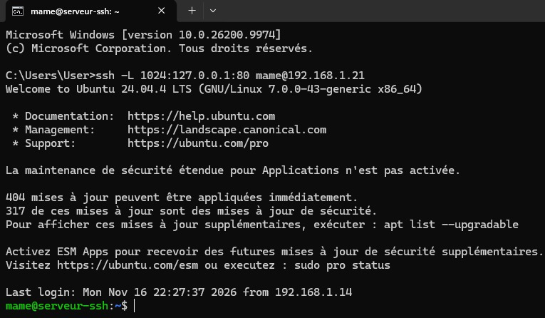


### Tunnel vers la base de données MariaDB

```bash
sudo apt install mariadb-server
sudo systemctl start mariadb
sudo systemctl status mariadb
sudo mysql -e "SHOW DATABASES;"
```

```powershell
ssh -L 3307:127.0.0.1:3306 mame@192.168.1.21
```

Le port 3307 du PC est redirigé vers le port 3306 (MariaDB) du serveur.

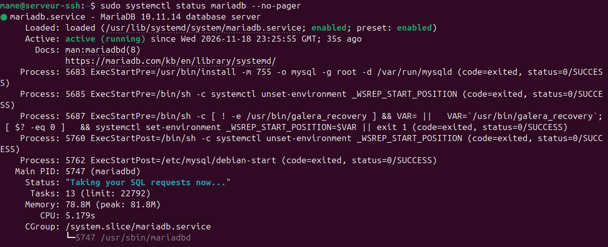

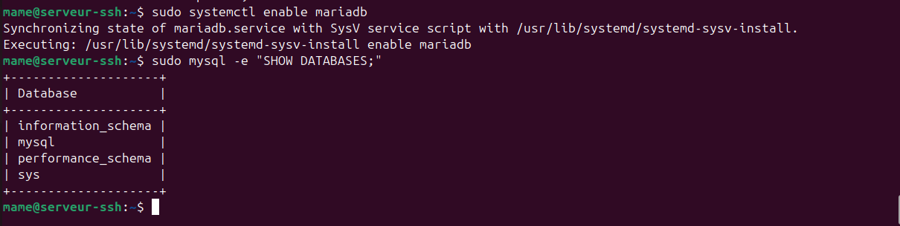

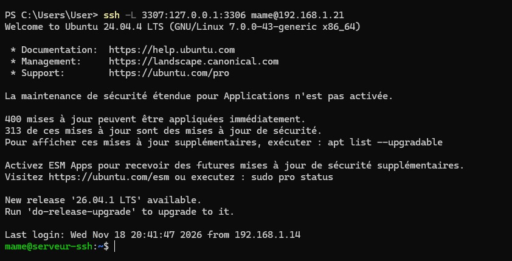

---

## Conclusion

Ce TP nous a permis d'installer un serveur SSH, de nous y connecter depuis Windows, de configurer une authentification par clés sans mot de passe et de créer des tunnels SSH chiffrés vers un serveur web et une base de données. Il montre que SSH sécurise l'accès distant et permet aussi de protéger d'autres protocoles.
